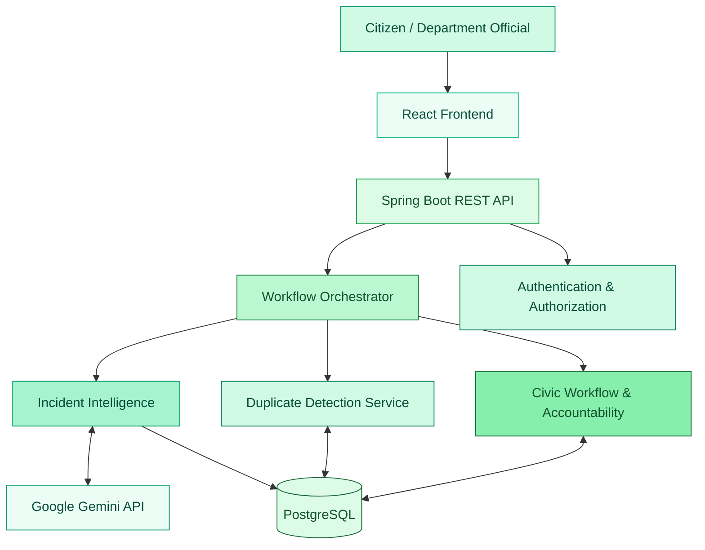
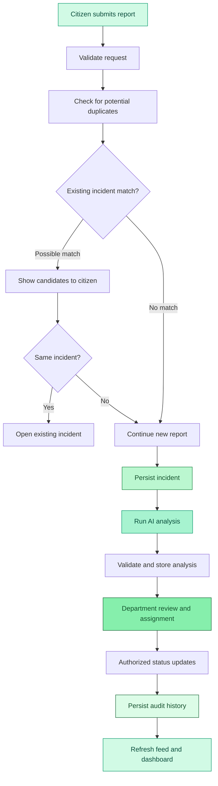

# CivicLens AI

<div align="center">


<br/>


<br/><br/>

[](https://github.com/)


**Making civic issues visible, actionable, and accountable.**

</div>

---

## Overview

**CivicLens AI** is an AI-assisted civic engagement platform designed to make reporting and tracking public infrastructure problems more transparent and organized.

From potholes and damaged roads to broken streetlights, overflowing garbage, water leakage, and drainage issues, CivicLens AI provides a centralized workflow for citizens to report problems, discover similar incidents, participate in community discussions, and track progress.

By combining AI-assisted incident intelligence with explainable duplicate detection and auditable departmental workflows, CivicLens AI aims to bridge the gap between **citizen participation and accountable civic action**.

## The Problem

Traditional civic grievance processes can be fragmented, repetitive, and difficult to track.

- **Fragmented reporting:** Civic issues are spread across multiple channels.
- **Duplicate complaints:** Different citizens may report the same underlying incident.
- **Unclear prioritization:** Safety-critical issues can be lost among routine maintenance requests.
- **Limited transparency:** Citizens may struggle to understand the status of a complaint.
- **Departmental ambiguity:** Identifying the responsible department can be difficult.
- **Weak accountability:** Status changes and resolution progress may not be consistently visible.

## Our Approach

<div align="center">

| 01 · REPORT | 02 · ANALYZE | 03 · CONNECT | 04 · RESOLVE |
|:---:|:---:|:---:|:---:|
| Submit civic issues | AI-assisted classification | Detect duplicates and gather support | Track authorized actions |
|  |  |  |  |

</div>

## Core Capabilities

### Incident Intelligence

Uses a Gemini-powered intelligence module to interpret unstructured reports and suggest structured categories, severity levels, explanations, and responsible departments.

### Explainable Duplicate Detection

Identifies potentially similar incidents using available text, category, and geographic signals. Citizens review candidate matches instead of reports being automatically merged based on similarity alone.

### Community Participation

Provides the backend capabilities for city-specific feeds, incident voting, comments, and discovery of recent or trending issues.

### Department Workflow

Supports authorized assignment, validated status transitions, and incident history to help make departmental actions traceable.

### Accountability & Analytics

Provides dashboard aggregates based on stored data, department reviews under defined rules, and a ledger-based approach to participation rewards.

### Resilient AI Integration

Validates AI-generated output and handles provider failures explicitly, so an unavailable AI service does not silently erase a citizen's report.

---

## System Architecture

<div align="center">


</div>



### Three Core Responsibilities

| Module | Responsibility |
|---|---|
| Incident Intelligence Agent | Uses an LLM to analyze complaints and provide validated, explainable recommendations. |
| Duplicate Detection Service | Uses deterministic matching and geographic signals when available to identify potential duplicates. |
| Civic Workflow & Accountability Service | Enforces permissions, department assignment rules, status transitions, audit history, and reward eligibility. |

These are three logical modules, not necessarily three autonomous AI agents. The architecture intentionally reserves LLM reasoning for tasks that benefit from language understanding.

## Technology Stack

<div align="center">


<br/><br/>


</div>

| Layer | Technology |
|---|---|
| Frontend | React, TypeScript |
| Backend | Java, Spring Boot |
| API | REST, OpenAPI / Swagger |
| Database | PostgreSQL |
| Persistence | Spring Data JPA / Hibernate |
| Migrations | Flyway |
| AI | Google Gemini API |
| Security | Spring Security, BCrypt, JWT if implemented |
| Testing | JUnit 5, Mockito, integration testing |
| Infrastructure | Docker, Docker Compose |

*The final repository should list only technologies actually used by the implementation.*

## Incident Lifecycle



AI analysis may be asynchronous depending on the final implementation. If analysis fails, the system should expose an appropriate pending or failed state while preserving the report.

## Security & Reliability

- Role-based access control for citizen and department operations.
- Server-side validation of requests and AI-generated output.
- Secure password hashing and environment-based secrets.
- Validated status transitions and auditable changes.
- Duplicate-resistant voting and reward operations.
- Structured error responses and diagnostic logging.
- Separation of public incident information from private account data.
- Explicit handling of external AI service failures.

## Getting Started

The commands below are examples. Follow the final repository's actual directory structure, environment variables, and setup instructions.

### Prerequisites

- Java 21 or the version specified by the backend.
- Maven or the included Maven wrapper.
- PostgreSQL or Docker with Docker Compose.
- Node.js and npm for the frontend.
- A Gemini API key for live AI analysis, if enabled.

### Run the Backend

```powershell
# Start PostgreSQL if Docker Compose is configured
docker compose up -d

# Enter the backend directory
cd backend

# Start Spring Boot on Windows
.\mvnw.cmd spring-boot:run
```

### Run the Frontend

```bash
cd frontend
npm install
npm run dev
```

### Environment Configuration

Use the provided `.env.example` and the backend documentation to configure the required variables, such as database credentials, the Gemini API key, JWT secret, server port, and frontend origin.

**Never commit real credentials or `.env` files to GitHub.**

## Testing

The backend should be tested for:

- Incident creation and retrieval.
- Duplicate detection and matching edge cases.
- AI output validation and provider failures.
- Authentication and role-based permissions.
- Voting, comments, and reward eligibility.
- Department assignment and status transitions.
- Audit history consistency.
- Dashboard aggregation and database persistence.

Refer to the project's test report for commands actually executed and verified results.

## Current Status

> Update this section as implementation progresses. Do not claim completion until the feature has been tested.

- [ ] Backend implementation verified
- [ ] Frontend integration verified
- [ ] Gemini integration verified
- [ ] Duplicate detection tested
- [ ] Department workflow tested
- [ ] End-to-end demo verified

## Future Scope

- Interactive geographic incident discovery.
- Multilingual reporting.
- Image-assisted damage classification.
- Verified municipal system integrations.
- Notifications and status subscriptions.
- Advanced civic analytics and abuse prevention.

These are potential extensions, not claims about existing functionality.

## Team

**Built for Forge26 Hackathon**

CivicLens AI explores how AI-assisted reasoning, community participation, and auditable workflows can help make civic issue management more transparent.

---

<div align="center">


<sub>Building more accountable communities through technology.</sub>

</div>
